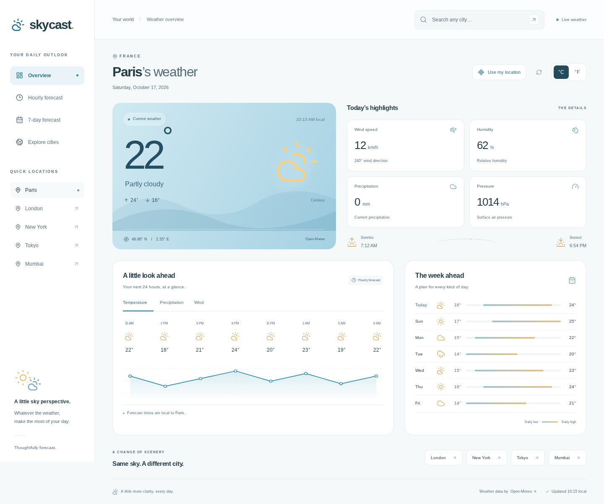

# Skycast

A responsive weather dashboard built with Next.js 14, React, TypeScript, and Open-Meteo. The home page opens Paris; city forecasts are shareable at routes such as `/Tokyo` or `/New%20York`.

## Preview

Desktop and mobile captures use sample weather data; the app itself fetches live forecasts.



[View the mobile layout](screenshots/skycast-mobile.png).

## Run locally

```sh
npm ci
npm run dev
```

Open http://localhost:3000. No API key or environment variables are required. Weather requests go directly to Open-Meteo, so an internet connection is needed.

## Features

- Search 47,000+ locations with city suggestions and quick location links.
- “Use my location” for forecasts at your device’s coordinates, with permission and failure feedback.
- Current conditions, humidity, precipitation, wind, pressure, sunrise, and sunset.
- Next-24-hour temperature, precipitation, and wind trends.
- Seven-day high/low forecast and Celsius/Fahrenheit switching.
- Responsive layouts, keyboard-accessible controls, reduced-motion support, and retryable errors.

City-name routes retain the original behavior: when multiple cities share a name, the first (most populous) match in the dataset is selected. Times are local to the selected location. Forecasts are informational, not severe-weather alerts.

Device location requires HTTPS (or localhost) and explicit browser permission. Coordinates are sent to Open-Meteo to fetch weather, but are not saved or added to the URL. Selecting a city clears the device-location forecast; reloading returns to the city in the URL.

## Folder structure

```text
app/                            Next.js routes, metadata, and global design styles
  page.tsx                      Default Paris dashboard
  [CityName]/page.tsx            Shareable city dashboard
features/weather/
  components/                   Dashboard shell, search, conditions, and forecasts
  data/cities.json               Existing worldwide city catalog
  lib/api.ts                    City lookup and cancellable weather requests
  lib/weather.ts                Formatting, WMO descriptions, and hourly selection
  types.ts                      Weather API and city types
tests/weather.test.mjs           Focused forecast/formatting regression tests
assets/                         Original weather artwork
public/                         Static assets
```

Feature-specific code lives together; route files only compose the dashboard. Styles use shared tokens in `app/globals.css`, with desktop, tablet, and mobile breakpoints.

## Checks

```sh
npm test             # Node.js 22.6+ (native TypeScript stripping)
npm run lint
npx tsc --noEmit
npm run build
```

An optional Playwright smoke test covers city navigation, unit/metric switching, error recovery, and layout overflow at 320–1440px. With the production server running:

```sh
pip install playwright
playwright install --with-deps chromium
python tests/browser.py
```

Weather data: [Open-Meteo](https://open-meteo.com/).

Original project by [Varun Gaikwad](https://www.linkedin.com/in/varun-gaikwad/).
